<p align="center">
  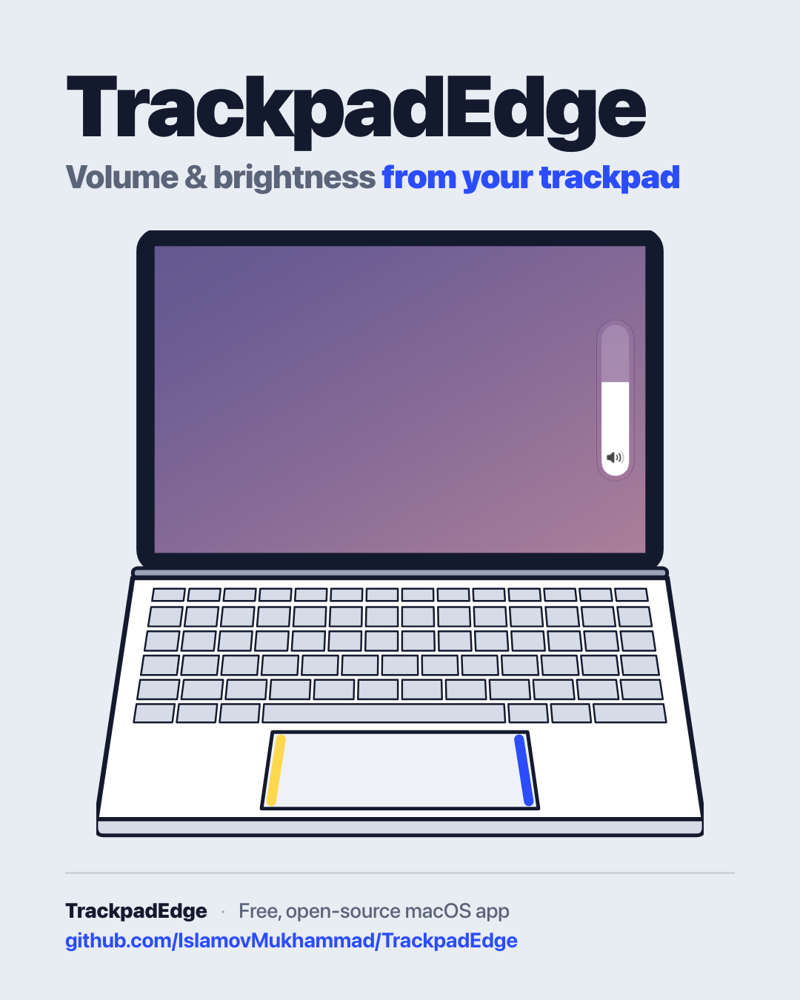
</p>

# TrackpadEdge

[](https://github.com/IslamovMukhammad/TrackpadEdge/actions/workflows/ci.yml)

**Slide two fingers in from the edge of your trackpad, then up or down: right edge = volume, left edge = brightness.**

A free, open-source menu-bar app for macOS, with ten on-screen indicator styles to choose from.

## Features

- **Right edge → volume, left edge → brightness.** One setting swaps the sides.
- **Never fires by accident.** Ordinary two-finger scrolling near the edge never changes anything. See [How the gesture works](#how-the-gesture-works).
- **Ten indicator styles**, from a macOS-style popover to a glass column at the screen edge (the default), an island around the notch, a ring, or a small capsule next to the pointer. Settings has a live preview of each.
- **Notch-aware**: on a MacBook with a notch, the Island style wraps the real notch, and the styles under the menu bar follow its real height.
- A haptic tick at 0 % and 100 %, smooth animations, and Reduce Motion is respected.
- Trackpad only. The volume and brightness keys and Control Centre keep macOS's own indicator.
- Launch at login. Native SwiftUI + AppKit, no third-party dependencies.

## How the gesture works

1. **Put two fingers on the edge** of the trackpad: the right edge for volume, the left edge for brightness. One finger has to be right at the edge (within ~6 mm), the other close by.
2. **Slide them inward a little** (about 6 mm).
3. **Now move up or down.** The value follows your fingers: about 70 mm of travel goes from 0 to 100 %.
4. **Lift a finger** to finish.

**Why sliding in comes first:** two fingers near the edge moving up or down is also how you scroll a page.
If up/down alone could start the gesture, scrolling near the edge would change your volume by accident. So
TrackpadEdge waits for the sideways slide-in. If your fingers move up or down by more than ~4 mm *before*
sliding in, the touch counts as a scroll and is left alone until you lift your fingers.

Also ignored: touches that start away from the edge, a palm resting on the pad, and anything within 0.6 s of a
key press (so typing can't trigger it).
While you are controlling, scrolling is held back so the page under the pointer doesn't move. While TrackpadEdge
waits for the slide-in, only sideways scrolling is held back, so the slide-in can't swipe a browser page back.

## Screenshots

### Indicator styles

All screenshots are real, taken with demo values (volume 62 %, brightness 48 %) on a plain background.

| | |
|---|---|
| **1 · Original (macOS 27.0)**<br>macOS's own popover, under the menu bar icon<br> | **2 · Segmented (macOS 27.2)**<br>One big icon and 16 segments, under the menu bar<br>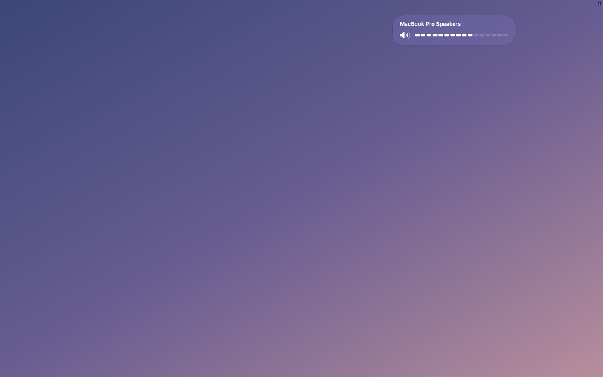 |
| **3 · Classic centre**<br>The classic square in the lower centre<br>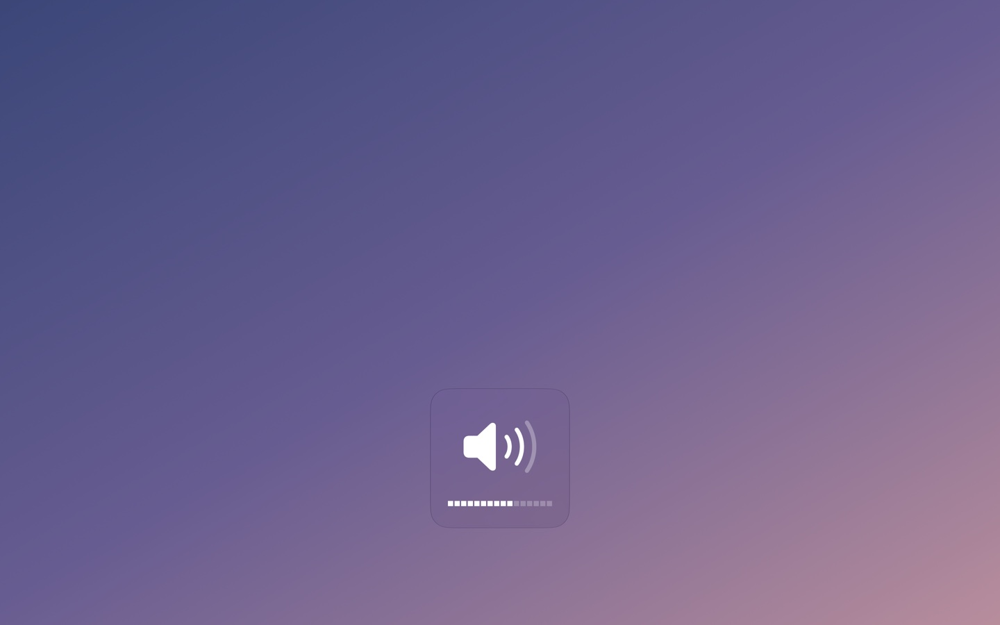 | **4 · Island**<br>Beside the notch, or a black island at the top<br>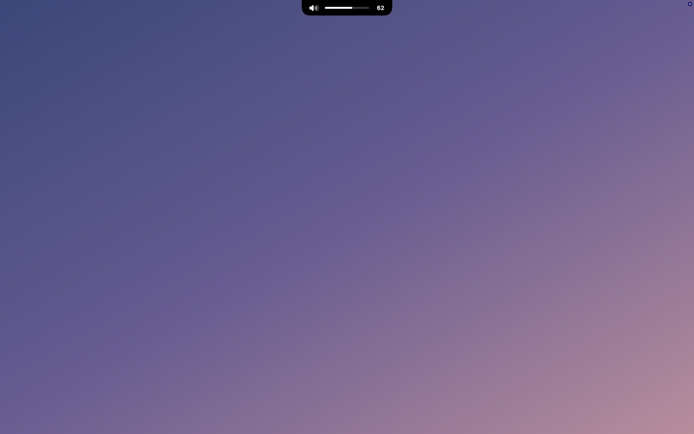 |
| **5 · Edge column (default)**<br>A glass column at the right edge; thins after a second<br> | **5 · Edge column, brightness**<br>The same column for the left edge<br>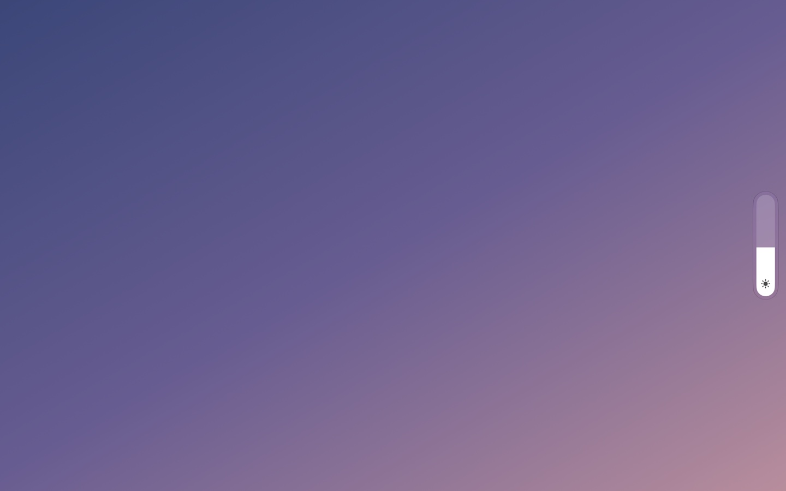 |
| **6 · Compact capsule**<br>A small capsule with the number, under the menu bar<br>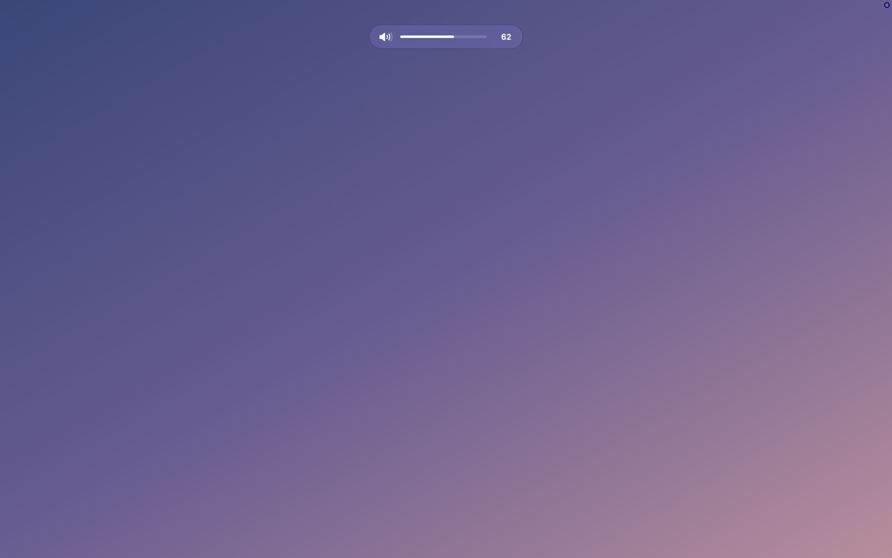 | **7 · Control Centre module**<br>Device name and a thick slider, top right<br>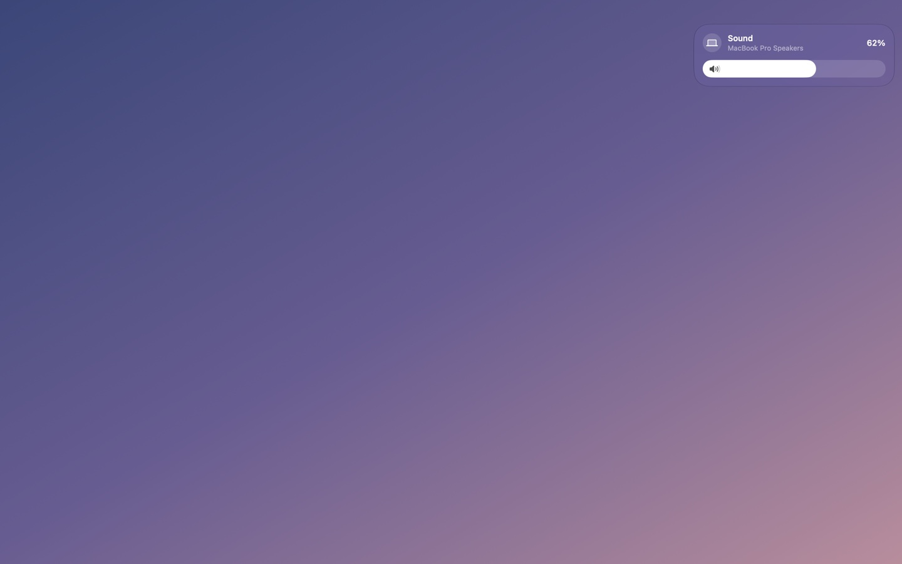 |
| **8 · Pair**<br>Volume and brightness together, top right<br>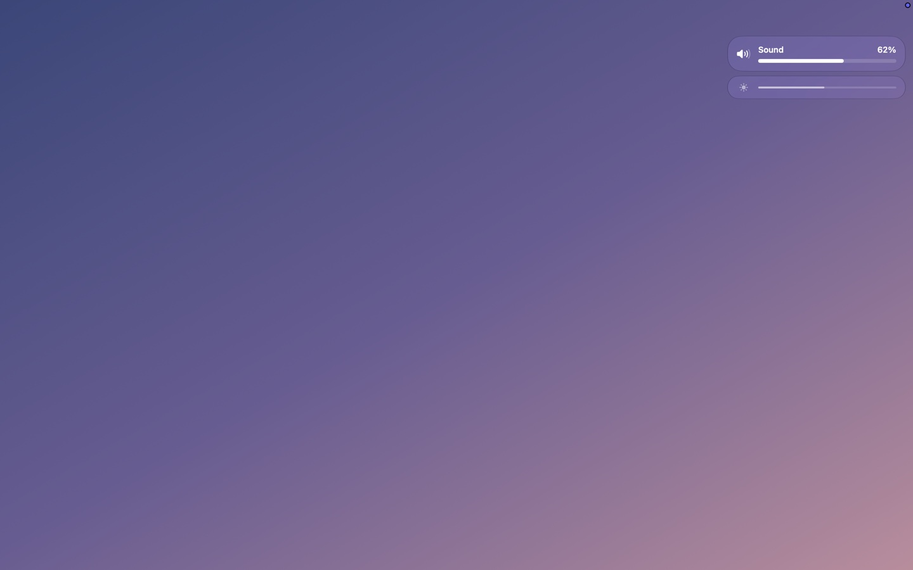 | **9 · Ring**<br>A thin ring with the number, lower centre<br>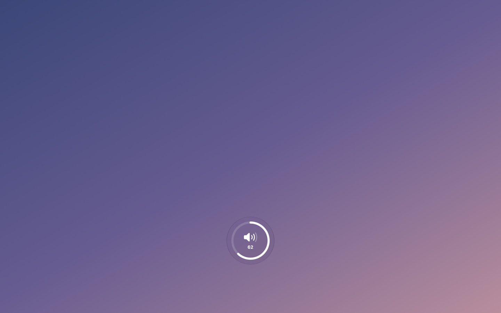 |
| **10 · Near cursor**<br>A small capsule next to the pointer<br>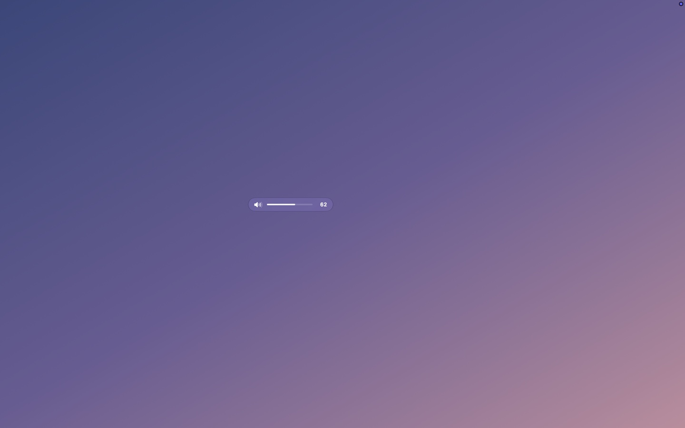 | |

### On a Mac with a notch

| | |
|---|---|
| **4 · Island** wraps the notch<br>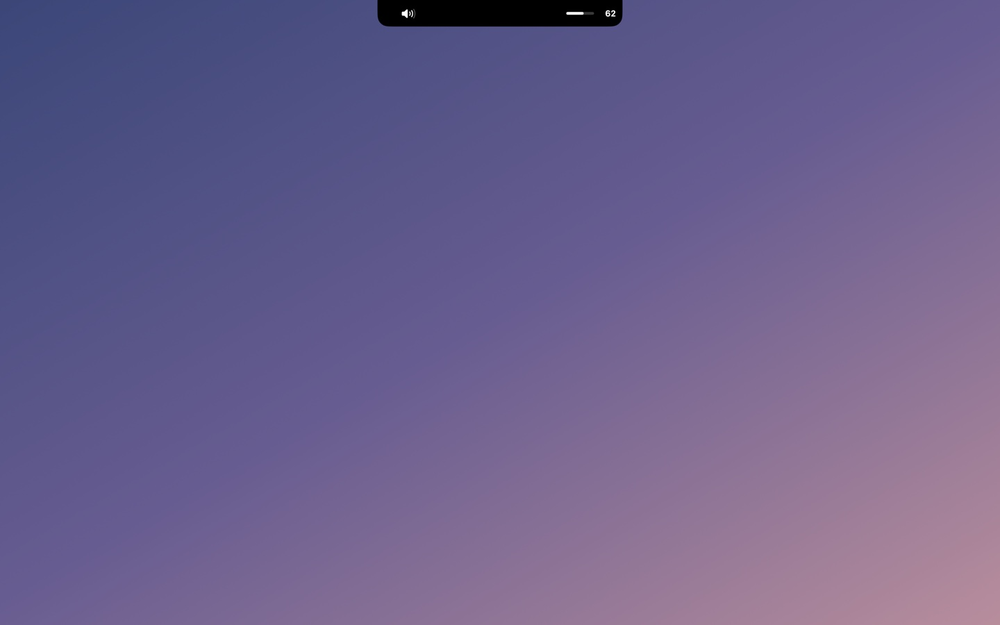 | **1 · Original** moves down with the taller menu bar<br>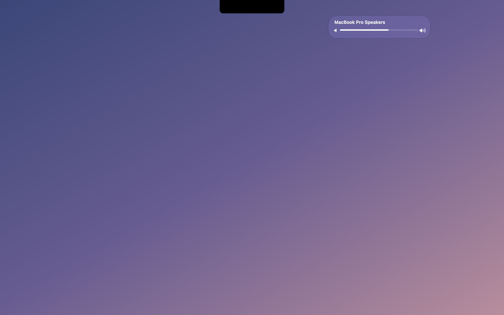 |
| **6 · Compact capsule**<br>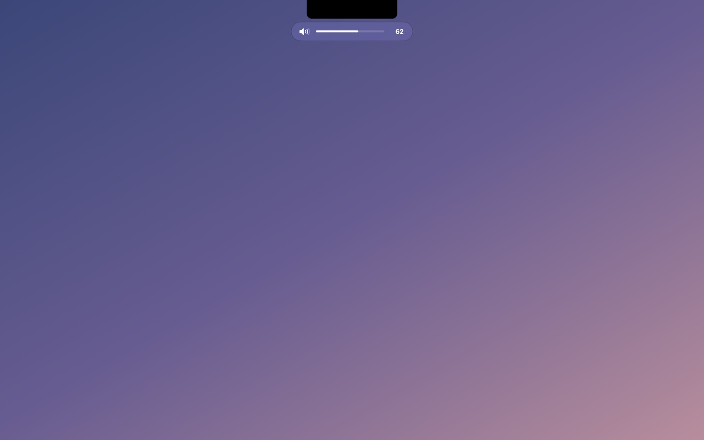 | **8 · Pair**<br>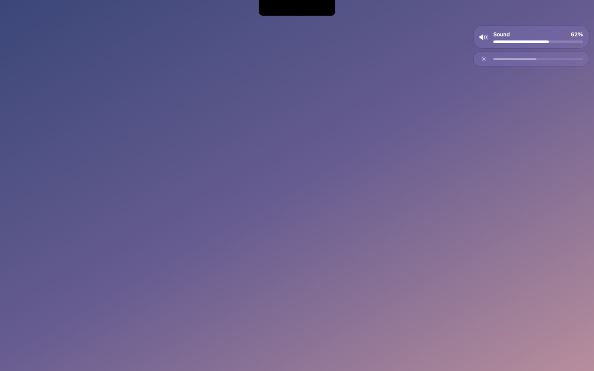 |

### Settings

<p align="center">
  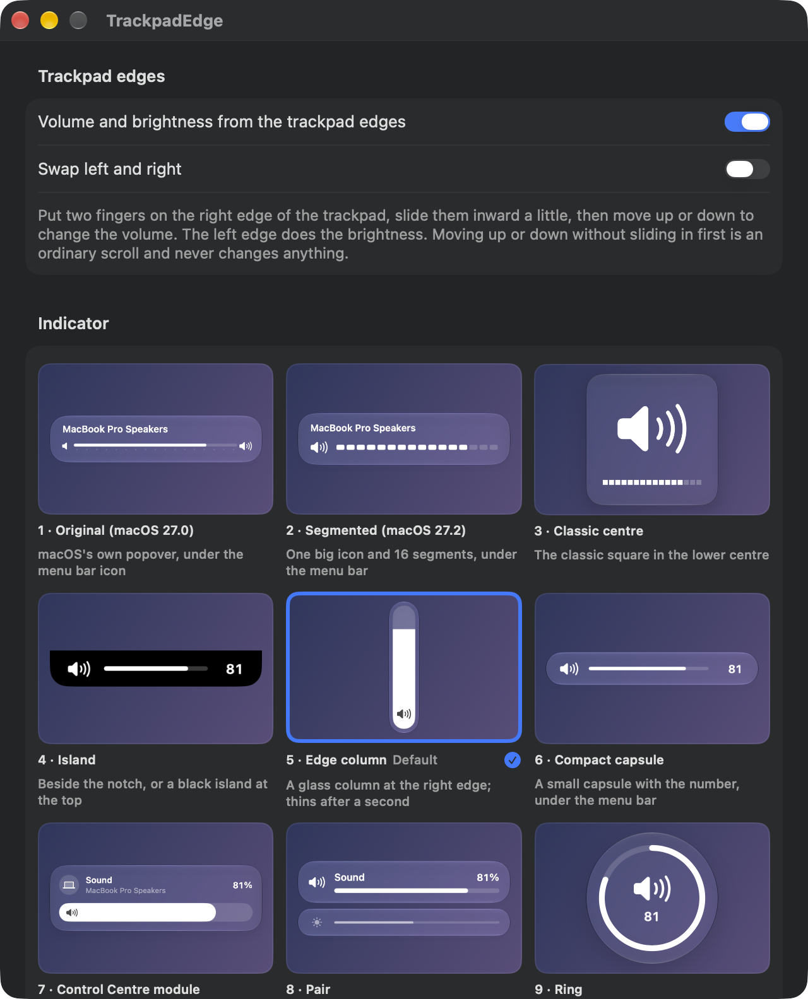
</p>

## Requirements

- macOS 26 or later
- A Mac with a trackpad (tested on a MacBook Pro's built-in trackpad)
- Xcode 26 / Swift 6.2 toolchain to build

## Permissions

- **Accessibility.** On macOS 27 it may be listed as **Device Control and Data Access**. It's needed to hold back
  scrolling while you control and to notice that you are typing. Without it the gesture still works, but scrolling
  isn't held back and the typing guard is off.
- Reading the trackpad itself needs no permission.
- **Launch it as an app** (Finder, Launchpad or `open build/TrackpadEdge.app`), not by running the binary from a
  terminal. Started from a terminal, it runs under the terminal's privacy permissions and receives no trackpad data.

## Build from source

There is no prebuilt download. Build it yourself in a minute:

```bash
git clone https://github.com/IslamovMukhammad/TrackpadEdge.git
cd TrackpadEdge
./build.sh --install   # builds, copies to /Applications and launches
```

`./build.sh` alone puts the app in `build/TrackpadEdge.app`. Run the tests with `swift test`.
The app icon is drawn in code: `swift Scripts/make_icon.swift` regenerates `Resources/AppIcon.iconset`.

If you have no Apple signing certificate the app is signed ad-hoc; macOS may then ask you to re-grant
Accessibility permission after every rebuild.

## How it works

| Part | File |
|---|---|
| Gesture rules: edge pairs, slide-in, scroll guard (pure, unit-tested) | `Sources/TrackpadEdge/Gesture/EdgeGesture.swift` |
| Trackpad frames, scroll blocking, typing guard, volume/brightness writes | `Sources/TrackpadEdge/Gesture/TrackpadEdgeControl.swift` |
| The ten indicator styles | `Sources/TrackpadEdge/HUD/HUDVariants.swift` |
| Indicator placement (menu bar, notch, edges) | `Sources/TrackpadEdge/HUD/HUDLayout.swift` |
| Indicator window and animations | `Sources/TrackpadEdge/HUD/HUDController.swift` |
| Volume (CoreAudio) and brightness | `Sources/TrackpadEdge/Services/` |

### Private APIs

macOS has no public API for raw trackpad touches or for the built-in display's brightness on Apple silicon.
TrackpadEdge loads these at runtime with `dlopen` (never linked). If one is missing, that part turns itself off
and Settings says so instead of the app crashing:

- `MultitouchSupport.framework`: `MTDeviceCreateList`, `MTRegisterContactFrameCallback`, `MTDeviceStart` and
  friends, which deliver raw finger positions. The touch record layout is undocumented.
- `DisplayServices.framework`: `DisplayServicesGetBrightness` / `DisplayServicesSetBrightness`.
- Volume uses CoreAudio's public API with the virtual main volume and mute properties of the default output device.

## Privacy

- TrackpadEdge has no network code, analytics or telemetry, and writes no files of its own. Its settings are
  kept in the app's standard preferences.
- It reads finger positions only to recognise the gesture, and keeps nothing.
- The keyboard monitor records only *when* a key was last pressed, never which key.

## Known limitations

- Brightness works on the built-in display only. External monitors aren't controlled.
- It relies on private frameworks with an undocumented touch layout, so a macOS update could break it.
- Styles 1 and 2 sit where the Sound and Display menu bar icons usually are (measured on one Mac); they don't look up where those icons actually are.
- The indicator appears on the screen that has the pointer.
- Not sandboxed (private frameworks plus an event tap), so it is not App Store material; source only.
- English UI only.

Bug reports and pull requests are welcome.

## Credits

Originally built as part of the author's personal desk companion app.

## License

[MIT](LICENSE) © 2026 Muhammad Islamov

## Follow

- GitHub: [@IslamovMukhammad](https://github.com/IslamovMukhammad)
- Telegram: [t.me/infinitwo](https://t.me/infinitwo)
